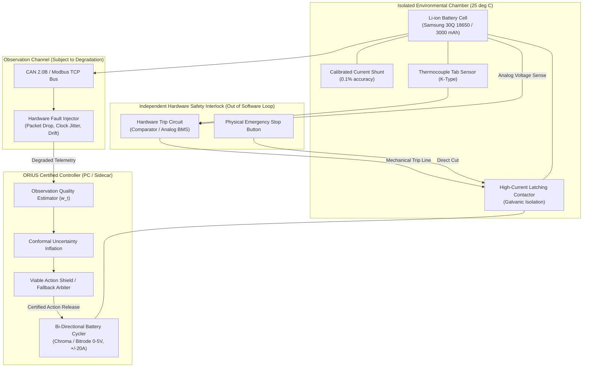

# ORIUS Physical Battery Hardware Test Protocol
**Issue OR-009 Foundational Specification**

---

## 1. Safety Architecture & Independent Hardware Protection

In accordance with the 9.8 foundational quality standard, physical hardware experiments must maintain **unambiguous physical independence** between the experimental software controller under test (ORIUS/DC3S) and the facility safety interlocks.

---

## 2. Hardware Topology & Specifications

| Component | Hardware Specification | Purpose | Assurance Boundary |
| :--- | :--- | :--- | :--- |
| **Cell Under Test** | Samsung 30Q 18650 NMC ($3.0\,\text{Ah}$, $3.6\,\text{V}$ nom) | Physical plant | Operates in explosion-proof chamber |
| **Battery Cycler** | Chroma 17011 / Bi-directional DC Supply ($\pm 20\,\text{A}$) | Actuation | Receives certified current/power setpoints |
| **Analog Watchdog** | Hardwired analog threshold circuit (Op-Amps) | Safety Interlock | Trips contactor if $V > 4.25\,\text{V}$, $V < 2.50\,\text{V}$, or $T > 55^\circ\text{C}$ |
| **Latching Contactor** | Gigavac GX14 high-voltage relay | Mechanical Isolation | Opens in $< 15\,\text{ms}$ upon watchdog trigger |
| **Fault Injector** | Microcontroller-based CAN bus bridge | Observation Degradation | Drops packets, introduces latency and bit flips |
| **Reference Logging** | NI cDAQ-9174 + NI 9211 (independent logger) | Ground-Truth Measurement | Auditable reference data logged at 1 kHz |

---

## 3. Degradation Regimes & Fault Injection Matrix

| Regime ID | Fault Type | Injected Parameter | Target Controller Behavior |
| :--- | :--- | :--- | :--- |
| **REG-A** | Baseline Nominal | 0% packet loss, $< 5\,\text{ms}$ latency | Full task utility, $w_t \approx 1.0$, zero interventions |
| **REG-B** | Burst Packet Drop | 20%–40% Markov dropout, burst lengths 3–15 steps | $w_t$ decays; conformal envelope inflates; zero violations |
| **REG-C** | Blackout / Loss-of-Comm | Total telemetry loss for $\Delta t = 2.0\,\text{s}$ | Immediate mandatory fallback ($u_{\mathrm{fb}} = 0\,\text{A}$ standby); zero violations |
| **REG-D** | Sensor Calibration Drift | $+0.1^\circ\text{C}/\text{s}$ simulated thermocouple bias | OQE detects residual innovation; tightens thermal headroom |
| **REG-E** | Latency Jitter | Poisson arrival delays $50\,\text{ms} \le \tau \le 500\,\text{ms}$ | Stale packet penalty invoked; safe current derating |

---

## 4. Test Execution & Pass/Fail Criteria

1. **Independent Watchdog Non-Activation**: The hardware analog watchdog relay must **NEVER trip** during any test run. If the watchdog trips, the software safety filter failed to prevent boundary penetration, and the test is marked an unconditional failure.
2. **True State Invariance**: Ground-truth reference measurements from the independent NI DAQ must confirm:
   - State of Charge remains strictly within $\text{SoC} \in [0.10, 0.90]$.
   - Tab temperature remains strictly $T_{\mathrm{tab}} \le 50.0^\circ\text{C}$.
   - Terminal voltage remains strictly within $V_{\mathrm{term}} \in [2.80\,\text{V}, 4.20\,\text{V}]$.
3. **Audit Provenance**: Every run must store raw CAN traces, independent DAQ streams, and serialized ORIUS release certificates with matching SHA-256 hashes in `reports/hil/`.
