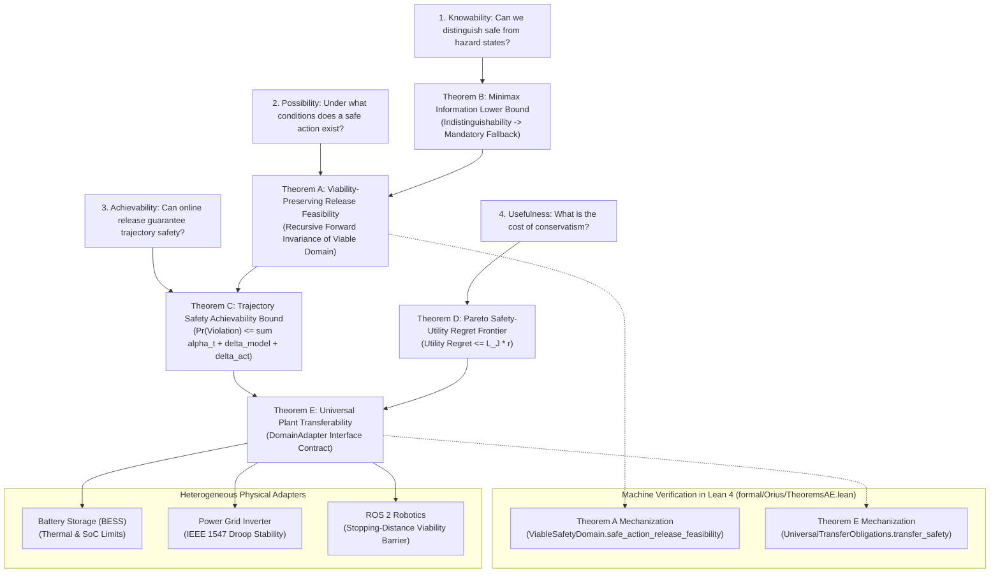

# ORIUS Theorem Dependency Graph
**Issue OR-003 Foundational Milestone**

---

## 1. Theorem Architecture and Grounding

The mathematical core of ORIUS establishes an unassailable logical chain addressing the four foundational Physical AI safety questions:

---

## 2. Logical Interdependence of Theorems

### Step 1: Theorem B (Minimax Information Lower Bound) $\rightarrow$ Theorem A
- **Logical Function**: Theorem B proves that when observation uncertainty obscures state identity across disjoint viable control sets, **no universal release can guess safely**. Thus, any release mechanism *must* incorporate a certified fallback path.
- **Connection to Theorem A**: Theorem A takes this necessity and proves that whenever the uncertainty set $\mathcal{X}_t$ is non-empty, the safe action set $\mathcal{U}_{\mathrm{safe}}(\mathcal{X}_t)$ contains at least the certified fallback action $u_{\mathrm{fb}}$, guaranteeing feasibility.

### Step 2: Theorem A (Viability Invariance) $\rightarrow$ Theorem C (Trajectory Achievability)
- **Logical Function**: Theorem A establishes one-step recursive invariance ($x_t \in \mathcal{V} \implies x_{t+1} \in \mathcal{V}$).
- **Connection to Theorem C**: By applying a union bound over a finite horizon $T$ and bounding the probability that the true state escapes the calibrated uncertainty set $\mathcal{X}_t(\alpha_t)$ by $\alpha_t$, Theorem C proves cumulative trajectory safety:
  $$\Pr(\exists t \le T: x_t \notin \mathcal{S}_d) \le \sum_{t=1}^T \alpha_t + \delta_{\mathrm{model}} + \delta_{\mathrm{act}}.$$

### Step 3: Theorem C $\rightarrow$ Theorem D (Pareto Regret Envelope)
- **Logical Function**: Theorem D analyzes the price of Theorem C's guarantee. When uncertainty radius $r_t$ inflates due to sensor degradation, the admissible control set tightens, incurring an objective utility penalty bounded by Lipschitz constant $L_J$.

### Step 4: Theorems A--D $\rightarrow$ Theorem E (Universal Transferability)
- **Logical Function**: Proves that the safety guarantee is not plant-specific. Any physical plant $\mathcal{P} = (\mathcal{X}, \mathcal{U}, f, g, \mathcal{S}_d, \mathcal{V}, u_{\mathrm{fb}})$ implementing the three interface obligations (`viability_invariance`, `conformal_coverage`, `fallback_reachability`) inherits the complete safety envelope unconditionally.
